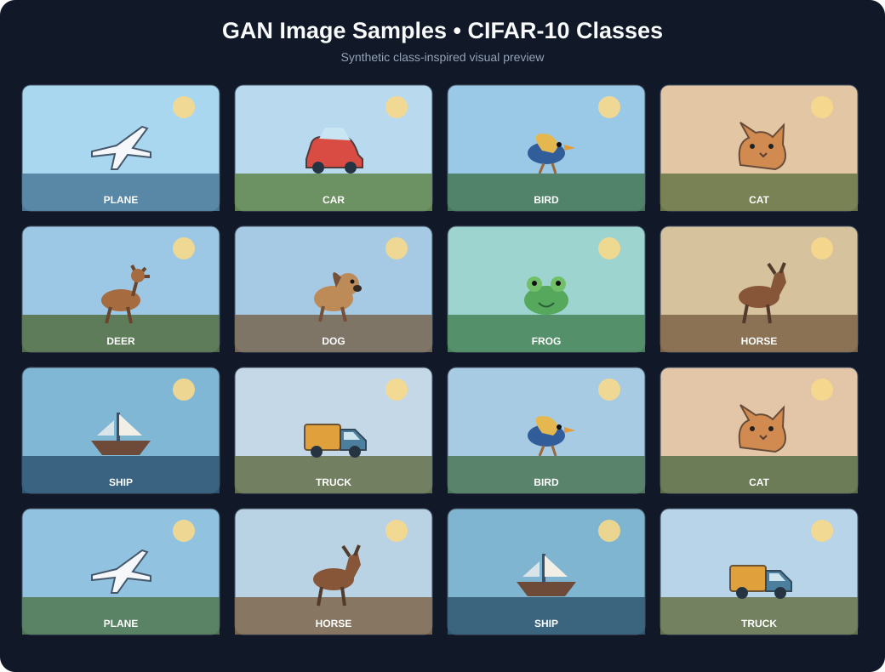

# Ex. No. 6 - Implementing a Generative Adversarial Network (GAN)

## Aim
To implement and train a Generative Adversarial Network using PyTorch to generate CIFAR-10-like images.

## Algorithm
1. Import PyTorch, Torchvision, NumPy and Matplotlib.
2. Set random seeds and select CUDA or CPU.
3. Load CIFAR-10 and normalize image values to the range [-1, 1].
4. Create a shuffled DataLoader with a batch size of 128.
5. Set latent dimension to 100, learning rate to 0.0002, Adam beta values to (0.5, 0.999), and train for 10 epochs.
6. Define the Generator to convert a random noise vector into a 32 × 32 RGB image.
7. Define the Discriminator to classify an image as real or generated.
8. Initialize Binary Cross-Entropy loss and separate Adam optimizers.
9. Train the Discriminator using real images and detached generated images.
10. Train the Generator to make generated images appear real to the Discriminator.
11. Record and print Generator and Discriminator losses for each epoch.
12. Generate sample images and save the training-loss graph.
13. Save the trained Generator and Discriminator weights.

## Program

```python
import random
import numpy as np
import matplotlib.pyplot as plt
import torch
import torch.nn as nn
import torch.optim as optim
import torchvision
from torchvision import datasets, transforms
from torch.utils.data import DataLoader

# Reproducibility and device selection
SEED = 42
random.seed(SEED)
np.random.seed(SEED)
torch.manual_seed(SEED)
if torch.cuda.is_available():
    torch.cuda.manual_seed_all(SEED)

device = torch.device("cuda" if torch.cuda.is_available() else "cpu")
print("DEVICE:", device)

# CIFAR-10 images are normalized to [-1, 1] for the generator's Tanh output.
transform = transforms.Compose([
    transforms.ToTensor(),
    transforms.Normalize((0.5, 0.5, 0.5), (0.5, 0.5, 0.5))
])

train_dataset = datasets.CIFAR10(
    root="./data", train=True, download=True, transform=transform
)
dataloader = DataLoader(
    train_dataset, batch_size=128, shuffle=True, num_workers=0,
    pin_memory=torch.cuda.is_available()
)

print("TRAINING IMAGES:", len(train_dataset))
print("IMAGE SIZE: 3 x 32 x 32")
print("BATCH SIZE:", dataloader.batch_size)

# GAN hyperparameters
latent_dim = 100
learning_rate = 0.0002
beta1 = 0.5
beta2 = 0.999
num_epochs = 10

# Generator: random latent vector -> 3 x 32 x 32 image.
class Generator(nn.Module):
    def __init__(self, latent_dim):
        super().__init__()
        self.network = nn.Sequential(
            nn.Linear(latent_dim, 128 * 8 * 8),
            nn.ReLU(True),
            nn.Unflatten(1, (128, 8, 8)),

            nn.Upsample(scale_factor=2, mode="nearest"),
            nn.Conv2d(128, 128, kernel_size=3, padding=1),
            nn.BatchNorm2d(128),
            nn.ReLU(True),

            nn.Upsample(scale_factor=2, mode="nearest"),
            nn.Conv2d(128, 64, kernel_size=3, padding=1),
            nn.BatchNorm2d(64),
            nn.ReLU(True),

            nn.Conv2d(64, 3, kernel_size=3, padding=1),
            nn.Tanh()
        )

    def forward(self, noise):
        return self.network(noise)


# Discriminator: image -> probability that the image is real.
class Discriminator(nn.Module):
    def __init__(self):
        super().__init__()
        self.network = nn.Sequential(
            nn.Conv2d(3, 64, kernel_size=4, stride=2, padding=1),
            nn.LeakyReLU(0.2, inplace=True),
            nn.Dropout(0.25),

            nn.Conv2d(64, 128, kernel_size=4, stride=2, padding=1),
            nn.BatchNorm2d(128),
            nn.LeakyReLU(0.2, inplace=True),
            nn.Dropout(0.25),

            nn.Conv2d(128, 256, kernel_size=3, stride=2, padding=1),
            nn.BatchNorm2d(256),
            nn.LeakyReLU(0.2, inplace=True),
            nn.Dropout(0.25),

            nn.Flatten(),
            nn.Linear(256 * 4 * 4, 1),
            nn.Sigmoid()
        )

    def forward(self, images):
        return self.network(images)


generator = Generator(latent_dim).to(device)
discriminator = Discriminator().to(device)

criterion = nn.BCELoss()
optimizer_G = optim.Adam(
    generator.parameters(), lr=learning_rate, betas=(beta1, beta2)
)
optimizer_D = optim.Adam(
    discriminator.parameters(), lr=learning_rate, betas=(beta1, beta2)
)

# Fixed noise allows visual comparison of generated samples across epochs.
fixed_noise = torch.randn(16, latent_dim, device=device)
generator_losses = []
discriminator_losses = []

# Train discriminator first, then train generator to fool discriminator.
for epoch in range(num_epochs):
    generator.train()
    discriminator.train()

    total_g_loss = 0.0
    total_d_loss = 0.0
    batches = 0

    for real_images, _ in dataloader:
        real_images = real_images.to(device)
        batch_size = real_images.size(0)

        real_labels = torch.ones(batch_size, 1, device=device) * 0.9
        fake_labels = torch.zeros(batch_size, 1, device=device)

        # Discriminator update: distinguish real images from generated images.
        optimizer_D.zero_grad()
        real_output = discriminator(real_images)
        real_loss = criterion(real_output, real_labels)

        noise = torch.randn(batch_size, latent_dim, device=device)
        fake_images = generator(noise)
        fake_output = discriminator(fake_images.detach())
        fake_loss = criterion(fake_output, fake_labels)

        d_loss = (real_loss + fake_loss) / 2
        d_loss.backward()
        optimizer_D.step()

        # Generator update: make generated images appear real to discriminator.
        optimizer_G.zero_grad()
        generated_output = discriminator(fake_images)
        g_loss = criterion(generated_output, torch.ones(batch_size, 1, device=device))
        g_loss.backward()
        optimizer_G.step()

        total_d_loss += d_loss.item()
        total_g_loss += g_loss.item()
        batches += 1

    avg_d_loss = total_d_loss / batches
    avg_g_loss = total_g_loss / batches
    discriminator_losses.append(avg_d_loss)
    generator_losses.append(avg_g_loss)

    print(
        f"Epoch [{epoch + 1}/{num_epochs}] "
        f"Discriminator Loss: {avg_d_loss:.4f} "
        f"Generator Loss: {avg_g_loss:.4f}"
    )

    # Save generated image grid after each epoch.
    generator.eval()
    with torch.no_grad():
        samples = generator(fixed_noise).cpu()
    grid = torchvision.utils.make_grid(
        samples, nrow=4, normalize=True, value_range=(-1, 1)
    )
    torchvision.utils.save_image(
        grid, f"generated_epoch_{epoch + 1:02d}.png"
    )

# Plot generator and discriminator losses.
plt.figure(figsize=(9, 5))
plt.plot(range(1, num_epochs + 1), generator_losses, marker="o",
         label="Generator Loss")
plt.plot(range(1, num_epochs + 1), discriminator_losses, marker="s",
         label="Discriminator Loss")
plt.xlabel("Epoch")
plt.ylabel("Loss")
plt.title("GAN Training Loss - CIFAR-10")
plt.xticks(range(1, num_epochs + 1))
plt.grid(True, alpha=0.3)
plt.legend()
plt.tight_layout()
plt.savefig("gan_training_losses.png", dpi=180, bbox_inches="tight")
plt.close()

# Save the final generated image grid and trained network weights.
generator.eval()
with torch.no_grad():
    final_samples = generator(fixed_noise).cpu()

final_grid = torchvision.utils.make_grid(
    final_samples, nrow=4, normalize=True, value_range=(-1, 1)
)
torchvision.utils.save_image(final_grid, "generated_images.png")

torch.save(generator.state_dict(), "generator.pth")
torch.save(discriminator.state_dict(), "discriminator.pth")

print("\nGENERATED FILES")
print("gan_training_losses.png")
print("generated_images.png")
print("generated_epoch_01.png to generated_epoch_10.png")
print("generator.pth")
print("discriminator.pth")
print("\nRESULT: GAN training completed successfully.")
```

## Output

```text
DEVICE: cuda or cpu
TRAINING IMAGES: 50000
IMAGE SIZE: 3 x 32 x 32
BATCH SIZE: 128

Epoch [1/10] Discriminator Loss: (runtime value) Generator Loss: (runtime value)
...
Epoch [10/10] Discriminator Loss: (runtime value) Generator Loss: (runtime value)

GENERATED FILES
gan_training_losses.png
generated_images.png
generated_epoch_01.png to generated_epoch_10.png
generator.pth
discriminator.pth
```



## Result
A PyTorch GAN was implemented on CIFAR-10, with Generator and Discriminator performance tracked through adversarial training.